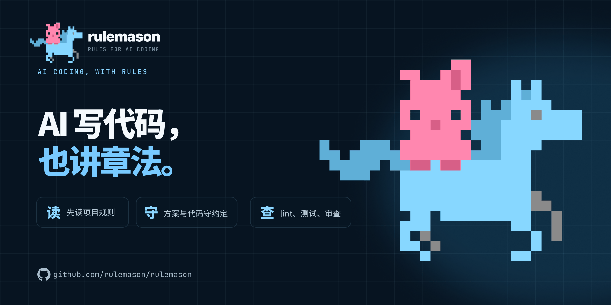
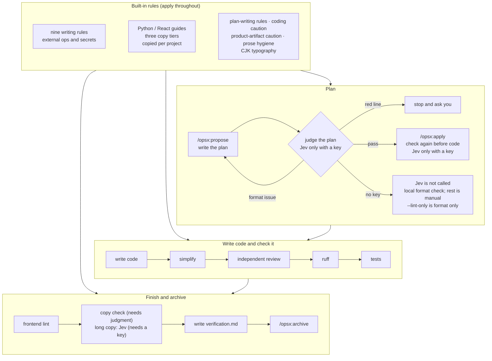

<p align="center">

</p>

# rulemason

**AI-written code that reads like a person wrote it.**

[中文](https://github.com/rulemason/rulemason/blob/main/README.md) · English

> **Language note:** the command-line output, the generated rules, and the skill text are written in Chinese. This page translates the [Chinese README](https://github.com/rulemason/rulemason/blob/main/README.md). rulemason works best if you can read that output, or are willing to read it through a translator.

<!-- TODO R2: same-task before/after recording, plus measured counts (lines, duplicate blocks, dead code). Do not publish numbers until measured. -->

Writing code with AI is fast. The hard part comes months later. Features pile up, and the code gets harder to follow: the same logic is copied several times, functions and parameters nobody calls stay where they are, and “we might need this later” adds another layer of abstraction. In the end even the engineers struggle to read it. It no longer looks like code a person wrote. Bugs are hard to trace, and the result is awkward to turn into material you would show someone else.

**rulemason is a set of rules for AI coding tools, plus a checkpoint after every change.** It supports Claude Code, Cursor, Codex, and OpenCode. The rules live in the project, and the AI follows them when it writes plans, code, and docs. After the code is written, the checkpoints have the AI simplify the change, ask an independent reviewer to read it, then run lint and tests. The change is done when those pass.

### Why I built it

I use AI to write code, and also to write PRDs, plans, and copy. As a project gains features, the code grows, the syntax gets more complicated, and even engineers have trouble understanding it. It stops looking like something a person wrote. Redundant code, duplication, and dead code keep increasing.

So I wrote these rules to constrain the AI: keep the code concise, the logic simple and easy to follow, and debugging straightforward. That also makes it easier to prepare materials for software copyright registration (软著) and patents. rulemason does not decide whether an application is approved.

### What you get

- **Less code.** After each change, the AI first removes duplication, dead code, extra abstraction, and roundabout logic in that change. The requirements and the observable behavior stay the same.
- **Logic you can read.** Nine writing rules. Examples: the first line of each file says what the file is for, the main flow is commented step by step, logic that appears a second time is extracted into a function, and unused parameters and functions are not left behind. Python is checked with ruff. React is checked with ESLint.
- **Easier debugging.** Errors are not swallowed inside the program; only the outermost layer handles them. Before fixing a bug, reproduce it and find the cause. Before saying it is fixed, the verification command has to have been run in that same turn.
- **Docs are constrained too.** PRDs, plans, and specs have a fixed shape: state what this change will not do, write down the rejected alternative for each decision, pair each risk with a mitigation, and say how a rollout rolls back. Chinese typography and stock phrases can be checked with a command.
- **Code you can hand to someone.** The structure is clear, the comments are in place, and each change keeps a check record. That saves time when you prepare a 软著 or patent filing. rulemason only looks after code and doc quality. It does not guarantee that any application will be approved.

[](https://pypi.org/project/rulemason/)
[](https://github.com/rulemason/rulemason/actions/workflows/ci.yml)
[](https://pypi.org/project/rulemason/)
[](https://github.com/rulemason/rulemason/blob/main/LICENSE)

[Three steps](#three-steps) · [With and without](#with-and-without) · [How it works](#how-it-works) · [FAQ](#faq)

## Three steps

You need [uv](https://docs.astral.sh/uv/) and Python 3.11 or newer. Checkpoints that involve plans and code need [OpenSpec](https://github.com/Fission-AI/OpenSpec) (`npm install -g @fission-ai/openspec@latest`). Without it, rulemason still installs the rules and lint setup; run `rulemason update` after OpenSpec is installed to fill in the checkpoints.

```bash
uv tool install rulemason    # 1. Once per machine
rulemason init               # 2. In the project root: pick your AI tools, read the plan, confirm, then write
```

This sets up the current directory. To set up another directory, run `rulemason init <project-root>`. A non-interactive terminal must pass both the tools and the confirmation: `rulemason init --tools claude,cursor --yes`. The tool ids are `opencode`, `claude`, `cursor`, and `codex`.

```txt
/rulemason                   # 3. Once inside the AI tool: check the project summary, confirm the red lines and the command table
```


<!-- TODO R9: recording of /rulemason checking the project summary, red lines, and command table. -->

After that, develop as usual. On the OpenSpec path the AI runs the checkpoints from the rules, so you do not have to remember the commands:

```txt
/opsx:propose <name>         # write the plan (Cursor and OpenCode: /opsx-propose; Codex: $openspec-propose)
/opsx:apply <name>           # write the code, then simplify, review, lint, and test
/opsx:archive <name>         # archive
```

`init` writes only the files in the plan. It does not commit or push. At the end it prints the `check` result, the files it changed, anything you still have to handle, and the next step.

<!-- TODO: measure the time from install to the first apply. Do not publish a duration until measured. -->

## With and without

| | Without rulemason | With rulemason |
|---|---|---|
| Code keeps growing | Duplication, dead code, and extra abstraction accumulate | Each change is simplified, then handed to an independent reviewer |
| Where the rules live | Separate copies in `CLAUDE.md` and `AGENTS.md`, synced by hand | Maintained in one place; every tool reads the same read-only copy, committed with the project |
| The AI says it is done | You run lint, tests, and a line-by-line review yourself | ruff, tests, and frontend lint run, must-fix issues are fixed, then the review runs again |
| Before any code | Whether the plan is good is up to you | With judgment on, the plan is checked when it is written and again before code; a red line stops and waits for you |
| Someone edits a rule | Nobody notices | `rulemason check` exits non-zero, so CI can block it |
| An existing project | Lint is red and there is no place to start | Set a baseline first; later checkpoints fix only problems the new change introduces |
| Switching tools or accounts | The rules are rewritten | `rulemason init` adds the new tool; the rules and checkpoints come along |
| Secrets and live systems | Left to the AI | Reads go ahead; each write needs your approval; deletion is handed to a person; secrets stay out of the chat |

<!-- TODO R10: recording of adding a second tool with rulemason init. The rule copies should stay the same. -->

## How it works



<!-- TODO R3: recording of /opsx:apply running simplify, review, ruff, and tests, plus verification.md. -->

- **Simplify.** Only duplication, dead code, extra abstraction, and overly complex logic in this change. Requirements, observable behavior, and APIs stay the same. On Claude Code this step uses its built-in `/simplify`.
- **Independent review.** The reviewer gets no files and no commands. It only sees the change and the plan it was given, and it reports on six points: requirements, correctness, security, code quality, tests, and whether the diff is clean. Must-fix issues, and comments that can be fixed safely inside the change, are fixed and reviewed again, for at most two rounds. If a must-fix issue is still there after that, the work stops and the remaining items are reported. You are not asked to review the code line by line.
- **Lint and tests.** Only problems introduced by this change are fixed. Problems that were already there are counted and left alone.
- **Judgment.** It runs after the plan is written and again before code, and it is optional. The plan is sent to Jev only when a key is set. The design-doc format check (a rejected alternative, a mitigation for each risk, and a rollback note) always runs locally and does not call Jev; `--lint-only` does only that part. With no key, Jev is not called, and the remaining rules are left for a person.
- **Copy check.** This runs when UI copy changed and judgment is enabled. Banned phrases and short labels are checked locally. Longer copy is sent to Jev only when a key is set. Without judgment it is skipped, and the report says the judgment layer is not installed (`判断层未装`). With no key, Jev is not called.
- **Small edits outside OpenSpec.** If the project has `openspec/`, the AI reads the main specs first. A change that would break a promised behavior stops and asks you. Anything else is edited directly, then ruff and tests run. Without OpenSpec there is no plan judgment; the edit is made and ruff and tests still run. Neither path simplifies, runs the independent review, or writes `verification.md`.

## Files it adds

All of these are committed with the project. Teammates, cloud agents, and CI can read them without installing rulemason.

| File | Role |
|---|---|
| `.rulemason/rules/` | Read-only copies of the rules the project actually uses (a Go project does not receive the Python or React rules) |
| `.rulemason/lint/` | Base ruff and ESLint rules; your config extends them |
| `.rulemason/result-check/` | Presets for copy and doc checks (written only the first time; your edits are not overwritten) |
| `AGENTS.md` | Project summary, red lines, command table, and the marked blocks that point at the rules |
| `CLAUDE.md` | Written when Claude Code is selected |
| `.claude/skills/rulemason/`, `.agents/skills/rulemason/` | The `/rulemason` skill. Cursor, Codex, and OpenCode share the `.agents/` copy |
| `opencode.jsonc` | Written when OpenCode is selected and the project has no OpenCode config yet; an existing config only gains the missing references |
| `ruff.toml` and other lint config | Created, or extended inside the config you already have |
| `openspec/config.yaml`, `openspec/specs/workflow-gates/spec.md` | With OpenSpec: plan-writing rules and the checkpoint spec |
| `.rulemason.yaml` | Selected tools, the rulemason version, the date the project was set up, and a checksum for each copy |

In `AGENTS.md` and `CLAUDE.md`, rulemason owns only the text between `<!-- rulemason:… -->` and `<!-- /rulemason:… -->`. Everything outside those markers is yours.

## Supported tools

| Tool | Where it reads the rules | `/rulemason` skill | OpenSpec commands |
|---|---|---|---|
| Claude Code | `CLAUDE.md` (which points at `AGENTS.md` and the rule copies) | `.claude/skills/rulemason/` | `/opsx:propose`, `/opsx:apply`, `/opsx:archive` |
| Cursor | `AGENTS.md` | `.agents/skills/rulemason/` | `/opsx-propose`, `/opsx-apply`, `/opsx-archive` |
| Codex | `AGENTS.md` | `.agents/skills/rulemason/` | `$openspec-propose`, `$openspec-apply-change`, `$openspec-archive-change` |
| OpenCode | `instructions` in `opencode.jsonc` | `.agents/skills/rulemason/` (if it is not in the `/` list, say “use the rulemason skill”) | `/opsx-propose`, `/opsx-apply`, `/opsx-archive` |

`openspec init` generates these commands, and the filenames it writes win if a version differs. In the table above, Claude Code uses a colon, and Cursor and OpenCode use a hyphen. Codex only gets skills, invoked with `$` plus the skill name. The colon commands for Claude Code are in this repo at `.claude/commands/opsx/`.

## Designed so you can trust it

- **Look before it writes.** `init` and `remove` list the files first and write only after you confirm. `update` refreshes the copies and entry points it owns immediately. For your own files (ruff, ESLint, `openspec/config.yaml`, and the like), a missing setting is listed in a fill-in plan and written only after you confirm. `init` and `remove` accept `--plan`; `update` accepts `--dry-run`. Those flags only print the plan.
- **It does not commit or push.** The changes stay in the worktree for you to review.
- **It does not force your config.** If a ruff config sets `select`, extends a file outside the project, or the ESLint config is in a form it cannot read, it reports the file, the line, the original text, and what to change.
- **An existing project does not go red on day one.** Run `/rulemason` to set a baseline. Nothing is written until you confirm. ruff can auto-fix import sorting and unused imports. FastAPI and Typer parameter defaults, and normal script output, are declared in the config. Everything else is recorded per file as pre-existing. ESLint, per file, turns off only the base rules that file breaks, and writes a complexity cap only for files that exceed the global one. No rule is switched off globally, and the global cap is not raised. After that, checkpoints fix only problems the new change introduces. <!-- TODO R5: recording of an existing-project baseline. Do not publish problem counts until recorded. -->
- **CI can block it.** If a rule copy is edited, a tool entry point is missing, or lint does not extend the base rules, `rulemason check` exits non-zero. If the recorded version is older and the copy contents match, the exit code stays 0.


- **Secrets stay out of the chat.** `rulemason key` reads the key in your own terminal, does not echo it, and does not put it in shell history. It is stored in `~/.config/rulemason/env` on this machine (mode 600 on POSIX) and is never committed. The environment variable `TYPESAFE_API_KEY` takes priority over that file.
- **You can remove it.** `rulemason remove --plan` shows what would be deleted and changes nothing; confirm to remove, and add `--yes` in a non-interactive shell. Generated copies, skills, and marker blocks go away. A copy you edited, so it no longer matches the recorded checksum, is kept and listed. The project summary, red lines, and command table stay in `AGENTS.md`. ruff and ESLint base files that are still referenced move to the project's `lint/` directory, and lint results stay the same.


## How to tell it is working

- When the AI reports completion, it writes the result of simplify, review, ruff, and tests, including what it skipped and why. An OpenSpec change also gets a `verification.md`.
- The review looks for unrelated edits, commented-out code, and debug output.
- Logic that appears a second time is extracted into a function. Parameters and functions nobody calls are not left behind.
- The first line of `rulemason check` is `日常巡检：一切一致`.

<!-- TODO: before/after counts from a real project (lines, duplicate blocks, dead code). Publish only measured numbers. -->

## Optional: judge plans and copy with Jev

Everything above works with no account. To have “does this plan break a written rule?” checked as well, turn on judgment. The Jev model from TypeSafe scores a plan, UI copy, and the note for a direct edit as pass / review / block. Saving a key does not turn judgment on by itself.

1. The project must be in git and have at least 3 archived OpenSpec changes. The “判断” line of `rulemason check` says what is still missing.
2. Run `rulemason key` in your own terminal (request a key at https://typesafe.ai/). You can also set `TYPESAFE_API_KEY` yourself.
3. In the AI tool, run `/rulemason` and say you want judgment enabled. It drafts the judgment rules, and you confirm them one by one.

You can check format without a key. `rulemason judge --change <name> --lint-only` checks the design doc only (a rejected alternative for each decision, a mitigation for each risk, and a rollback note). It does not use the network.


## FAQ

<details>
<summary><strong>How is this different from writing AGENTS.md or CLAUDE.md myself?</strong></summary>

A hand-written rule file is a prompt. The AI might follow it, and it might not, and nobody notices if it is edited. rulemason adds three things: the rules are maintained in one place and every tool reads the same copy; finished code goes through a fixed set of checkpoints; `rulemason check` can fail CI when a copy is edited or an entry point is missing. Your own text still lives outside the markers.

</details>

<details>
<summary><strong>How does it relate to OpenSpec?</strong></summary>

OpenSpec is how a plan is written and carried out step by step. rulemason is which rules to follow while writing, and which checkpoints to pass when the writing is done. rulemason adds the plan-writing rules to `openspec/config.yaml` and attaches the checkpoints to apply and archive. Without OpenSpec, you get the rules and lint setup only.

</details>

<details>
<summary><strong>Does it conflict with workflow plugins such as superpowers or get-shit-done (GSD)?</strong></summary>

They focus on different things. Those plugins mainly tell the AI how to plan and carry out a task. rulemason mainly says what the code and docs should look like, and how to check them after they are written. The rules are committed with the project, so CI can check them.

<!-- TODO: try installing rulemason together with superpowers and with GSD. Do not claim they coexist until that is done. -->

</details>

<details>
<summary><strong>Will it damage my project?</strong></summary>

`init` writes only the files in the plan, and it does not commit or push. Lint config it cannot rewrite is reported, not forced. To look first, run `rulemason init --plan`. To leave, run `rulemason remove --plan` and read what would be deleted.

</details>

<details>
<summary><strong>Does it need a network? Does it cost money?</strong></summary>

The rules, the checkpoints, `check`, `result-check`, and `judge --lint-only` all run on your machine. Only Jev judgment calls TypeSafe over the network, and the key comes from https://typesafe.ai/. Pricing is whatever that site says at the time.

</details>

<details>
<summary><strong>Can I use it if I do not read Chinese?</strong></summary>

The command-line output, the generated rules, and the skill are written in Chinese. This page is the English version of the [Chinese README](https://github.com/rulemason/rulemason/blob/main/README.md). The output you see while using it is still Chinese.

</details>

<details>
<summary><strong>Can it file a software copyright or a patent for me?</strong></summary>

No, and it does not guarantee that any application will be approved. What it can do is keep the code concise, the structure clear, and the comments in place, with a check record for each change. Those make the filing materials easier to prepare.

</details>

## Common commands

| When | Command |
|---|---|
| First time in a project, or to add or remove AI tools | `rulemason init` |
| After an upgrade, to fill in missing config, or to restore an edited copy | `rulemason update` |
| See the current state and the next step; also for CI | `rulemason check` |
| Inside the AI tool: fill in the summary, red lines, and command table, or enable judgment | `/rulemason` |
| Diagnose leftovers in the whole repo, or clean one module | `/rulemason cleanup` |
| Configure the key once, when you enable judgment | `rulemason key` |
| Judge one plan by hand | `rulemason judge --change <name>` |
| Check a piece of text or a structured record | `rulemason result-check --record <record.json> --preset hint` |
| Stop using it in this project | `rulemason remove` |

## Advanced

<details>
<summary><strong>CI</strong></summary>

Pin the version to the `rulemason:` line in the project's `.rulemason.yaml`. CI then does not fail just because someone upgraded their own machine. If that recorded version is older and the copy contents match, the exit code is still 0.

```yaml
- uses: astral-sh/setup-uv@v7
- run: uv tool install rulemason==<version>
- run: rulemason check
```


<!-- TODO R4-ci: screenshot of a pull request whose rulemason check is red after a rule copy is edited. -->

</details>

<details>
<summary><strong>Upgrade</strong></summary>

```bash
uv tool upgrade rulemason   # upgrade the rulemason program on this machine: once per machine
rulemason update            # refresh the copies committed in the project: once per project
```

One person runs `rulemason update` and commits. Everyone else pulls and only upgrades their own machine. Copies and entry points that rulemason owns are refreshed immediately. Your own files (ruff, ESLint, `openspec/config.yaml`, and the like) get a fill-in plan when something is missing, and that plan is written only after you confirm. In a non-interactive shell, add `--yes`.

</details>

<details>
<summary><strong>Existing projects: baseline and cleanup</strong></summary>

After setup, run `/rulemason` in the AI tool. Nothing is written until you confirm. ruff can auto-fix import sorting and unused imports. FastAPI and Typer parameter defaults, and normal script output, are declared in the config. Everything else is recorded per file as pre-existing. ESLint, per file, turns off only the base rules that file breaks, and writes a complexity cap only for files that exceed the global one. No rule is switched off globally, and the global cap is not raised. After that, checkpoints fix only new problems.

To clear what remains, run `/rulemason cleanup`. With no module name it only diagnoses and changes nothing. It lists the modules still to do, and the last line is either the next cleanup command or the paths to commit first. With a module name it cleans just that module: it lists the plan first, and you can accept only some of it. You commit the result. Title the commit `refactor(cleanup): <module>` and the next diagnosis treats that module as done.

<!-- TODO R5: recording of an existing-project baseline. Do not publish problem counts until recorded. -->

</details>

<details>
<summary><strong>Chinese typography and stock phrases (result-check)</strong></summary>

`rulemason result-check` checks a text or a structured record that already exists. The result is deterministic and does not call a model.

- `--preset hint` / `--preset strict` (also `prose-hygiene.hint` / `prose-hygiene.strict`) checks stock phrases, such as a closing `希望对你有帮助`. The default hint only warns. strict exits non-zero on a hit.
- `--preset product-artifact.hint` / `product-artifact.strict` checks that a PRD or requirements doc has sections such as “non-goals” and “acceptance criteria”. It checks structure only. It does not prove the requirements are right.
- `--preset verification-walkthrough.hint` / `verification-walkthrough.strict` checks that a walkthrough has sections such as an observable expectation and a list of gaps. A heading does not mean the product was tested.
- To check Chinese typography, write your own requirements with `type: cjk_typography`: a space between Han characters and Latin letters, no fullwidth digits, no stacked punctuation, and the rest of the rules.

`init` and `update` only distribute these rules and presets. They do not scan the repo, and they do not change the exit code of `check`. Add `--help` for the full scope and the exit codes: 0 is a pass (warnings allowed), 1 is a failure or an item that could not be judged, 2 is bad input.


</details>

<details>
<summary><strong>Several projects in one folder</strong></summary>

Run `rulemason init` in each project. Do not set up the folder itself. If that folder has no recognized language and contains other repositories, `init` and `check` print an extra hint. To change several projects in one session, open the AI tool in the main project and attach the others. The checkpoints then run once per project, using the files that were changed. Claude Code does not read an attached directory's `CLAUDE.md` unless you set:

```bash
cd products/app
CLAUDE_CODE_ADDITIONAL_DIRECTORIES_CLAUDE_MD=1 claude --add-dir ../api
```

</details>

<details>
<summary><strong>For AI tools and scripts</strong></summary>

```bash
rulemason check --json                # structured result; next.code is a stable action code; same exit code
rulemason init --plan --json          # list the setup plan only: no writes, no questions, no openspec init
rulemason update --dry-run --json     # list the upgrade and fill-in plan only
```

`--json` cannot be passed to `init` or `update` on its own. Without `--plan` or `--dry-run` it errors and writes nothing. `/rulemason` reads `check --json`.

Project code can import the engine: `from rulemason.judge import load_rules, verdict_or_pending`.

</details>

<details>
<summary><strong>More judgment commands</strong></summary>

```bash
rulemason judge --change <name> --dry-run     # print the request that would be sent
rulemason judge --copy                        # review new or edited UI copy (needs openspec/judge.yaml)
rulemason judge --direct note.md              # review a note for an edit made outside OpenSpec
rulemason judge --template judgments          # print a template used to enable judgment
```

`--template` also accepts `judge` and `judge_cases`. The shared rule `direct-route-respects-specs` currently returns review only and does not block. Judgment connects directly to TypeSafe. If that direct connection is refused because of the region (HTTP 451) and this machine already has a proxy, it retries through the proxy and says so. It does not go looking for a proxy. Linux and WSL only see variables such as `HTTPS_PROXY`. macOS and Windows also see the system proxy.

</details>

## When something is wrong

Run `rulemason check` and follow the first line. The lines below are the real output, in Chinese:

| First line of `check` | Why | What to do |
|---|---|---|
| `接入：运行 rulemason update` | A copy or marker was edited, an entry point is missing, or config is incomplete | Run `rulemason update`. To change a rule, change it in the rulemason repo and release a new version |
| `接入：修改 .gitignore，放行 skills/rulemason/（副本要随项目提交）` | `.gitignore` ignores a tool directory, so the copy cannot be committed | Allow only `skills/rulemason/`. Put the explanation on its own line; git does not support end-of-line comments |
| `接入：运行 rulemason init` | This directory is not set up | Run `rulemason init` in the directory you want |
| `接入：手动修改 <文件>（rulemason update 改不了）：…` | The lint config uses a form rulemason will not decide for you | Follow the file, line, and instructions under “接入 lint 继承”, then run `rulemason check` |
| `接入：先修正 .rulemason.yaml` | The manifest cannot be read | Fix it as the message says, or delete it and run `rulemason init` again |
| `补项目信息：在 AI 工具中运行 /rulemason` | The summary, red lines, or command table still need confirmation | Run `/rulemason` in the AI tool |
| `日常巡检：先升级本机 rulemason` | The version recorded in the project is newer than the local install | Run `uv tool upgrade rulemason`, or install the recorded version |
| `日常巡检：一切一致；版本号落后（…），副本内容相同` | Only the recorded version is older; the copy contents match | Keep using it. Run `rulemason update` when you want the record refreshed. The exit code is still 0 |

## Contributing

A change to the shared rules affects every project that uses them. Open an OpenSpec change in this repo, verify it in the projects it affects, release a new version, then run `rulemason update` in each project.

```bash
git config core.hooksPath .githooks   # enable the pre-commit hook that blocks machine-local paths (once per clone)
uv sync
uv run ruff check .
uv run pytest
```

## License

[Apache-2.0](https://github.com/rulemason/rulemason/blob/main/LICENSE). Copyright notices are in [NOTICE](https://github.com/rulemason/rulemason/blob/main/NOTICE).
