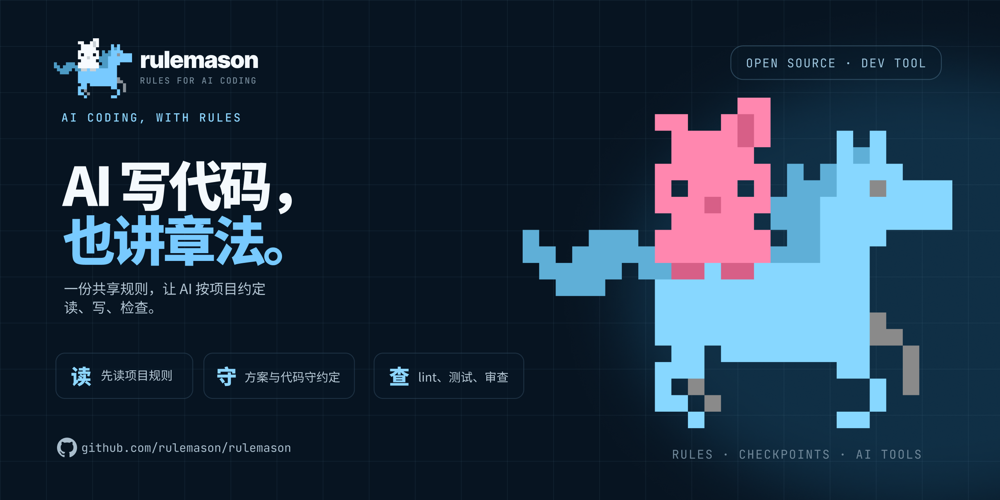
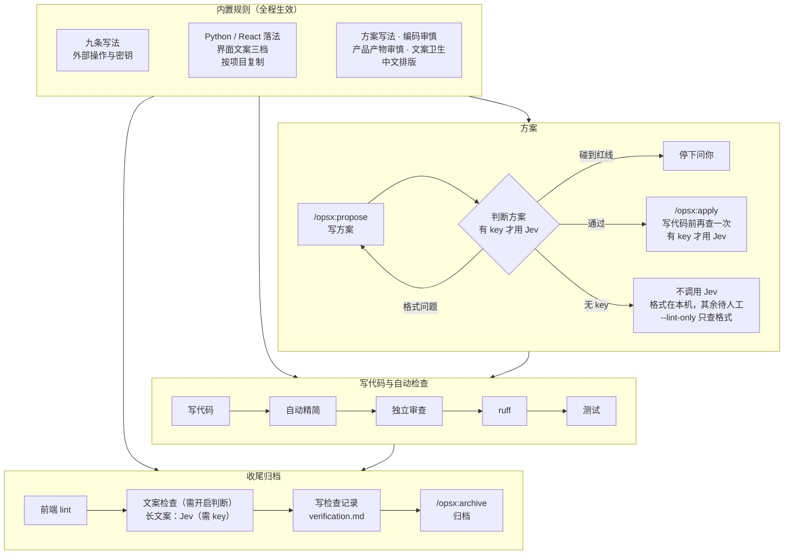

<p align="center">

</p>

# rulemason

**让 AI 写的代码，读起来像人写的。**

中文 · [English](https://github.com/rulemason/rulemason/blob/main/README.en.md)

<!-- TODO R2: same-task before/after recording, plus measured counts (lines, duplicate blocks, dead code). Do not publish numbers until measured. -->

用 AI 写代码很快，难的是几个月以后。功能一个个加上去，代码越堆越多，写法越来越绕：同一段逻辑复制了好几份，没人调用的函数和参数留在原处，为了“以后可能用到”套了一层又一层抽象。到最后，连工程师自己都很难看懂，读起来完全不像人写的代码。出了问题不好查，想整理成材料拿出去也拿不出手。

**rulemason 是给 AI 编码工具定的一套规矩，外加每次改动都要过的关卡。** 支持 Claude Code、Cursor、Codex、OpenCode。规矩写在项目里，AI 写方案、写代码、写文档时照着做；写完代码，关卡会让 AI 先精简、请一个独立的审查者看一遍，再跑 lint 和测试，过了关才算完成。

### 我为什么做这个

我平时用 AI 写代码，也用它写 PRD、写方案、写文案。项目功能越加越多以后，代码越来越多，语法越来越复杂，连工程师都很难理解，完全不像人写的。冗余、重复、死代码也越来越多。

所以我做了这套规则来约束 AI：让代码更精简，逻辑简单易懂，方便调试，后期申请软著、整理专利材料也更方便。

### 接入后你会得到

- **更少的代码**：每次写完，AI 先把这次改动里的重复、死代码、多余的抽象和绕弯的逻辑精简掉，需求和对外行为保持不变。
- **看得懂的逻辑**：九条写法规矩，比如每个文件第一行写它是干什么的、主流程按步骤写注释、同一段逻辑出现第二次就抽成函数、不留没人调用的参数和函数。Python 由 ruff 自动检查，React 由 ESLint 自动检查。
- **好调试**：错误不在内部被悄悄吞掉，只在最外层统一处理；修 bug 前先复现、找根因，说“修好了”之前必须在当次跑过验证命令。
- **文档也受约束**：PRD、方案、规格有固定写法，比如必须写“这次不做什么”、每个决策要写被否决的备选方案、风险要写对策、上线要写回滚方式。中文排版和套话也可以用命令检查。
- **代码拿得出手**：结构清楚、注释到位、每次改动都留有检查记录，申请软著、整理专利材料时更省事。rulemason 只管代码和文档质量，不保证任何申请能通过。

[](https://pypi.org/project/rulemason/)
[](https://github.com/rulemason/rulemason/actions/workflows/ci.yml)
[](https://pypi.org/project/rulemason/)
[](https://github.com/rulemason/rulemason/blob/main/LICENSE)

[三步上手](#三步上手) · [用和不用的区别](#用和不用差在哪) · [怎么工作](#怎么工作) · [常见问题](#常见问题)

## 三步上手

需要 [uv](https://docs.astral.sh/uv/)，Python 3.11 或更高。方案和代码的关卡需要 [OpenSpec](https://github.com/Fission-AI/OpenSpec)（`npm install -g @fission-ai/openspec@latest`）；没装也能先只接入规矩和 lint，装好后运行 `rulemason update` 补齐。

```bash
uv tool install rulemason    # 1. 每台机器装一次
rulemason init               # 2. 在项目根目录运行：勾选你用的 AI 工具，看一眼计划，确认后写入
```

默认接入当前目录。目录不对时写成 `rulemason init <项目根>`。终端不能提问时要同时带上工具和确认：`rulemason init --tools claude,cursor --yes`。工具 id 是 `opencode`、`claude`、`cursor`、`codex`。

```txt
/rulemason                   # 3. 在 AI 工具里运行一次：核对项目简介、确认红线和命令表
```


<!-- TODO R9: recording of /rulemason checking the project summary, red lines, and command table. -->

之后照常开发。走 OpenSpec 时，关卡由 AI 按规矩执行，不用记命令：

```txt
/opsx:propose 功能名         # 写方案（Cursor、OpenCode 里是 /opsx-propose；Codex 是 $openspec-propose）
/opsx:apply 功能名           # 写代码，写完自动精简、审查、lint、测试
/opsx:archive 功能名         # 归档
```

`init` 只写计划里列出的文件，不提交、不推送。结尾会给出 `check` 的结论、这次改了哪些文件、还要你处理的事，以及下一步。

<!-- TODO: measure the time from install to the first apply. Do not publish a duration until measured. -->

## 用和不用，差在哪

| | 不用 rulemason | 用 rulemason |
|---|---|---|
| 代码越写越多 | 重复、死代码、多余抽象慢慢堆积 | 每次写完先精简这次的改动，再交给独立审查者 |
| 规矩放在哪 | `CLAUDE.md`、`AGENTS.md` 各写一份，手动同步 | 只在一处维护；每个工具读同一份只读副本，随项目提交 |
| AI 说“写完了” | 你自己跑 lint、跑测试、逐行审 | ruff、测试、前端 lint 自动跑完，必须修的问题修好再审一遍 |
| 写代码之前 | 方案好不好全靠你看 | 开启判断后，方案写完、写代码前各查一次，碰到红线就停下等你 |
| 规矩被改了 | 没人发现 | `rulemason check` 以非 0 退出，放进 CI 就能拦住 |
| 老项目接入 | lint 一片红，无从下手 | 先建基线，之后只修每次改动新引入的问题 |
| 换工具或账号 | 规矩重写一遍 | `rulemason init` 加上新工具，规矩和关卡原样带过去 |
| 密钥与线上操作 | 看 AI 自觉 | 读可以直接做；改东西每次都要你同意；删除只给入口，由人操作；密钥不进对话 |

<!-- TODO R10: recording of adding a second tool with rulemason init. The rule copies should stay the same. -->

## 怎么工作



<!-- TODO R3: recording of /opsx:apply running simplify, review, ruff, and tests, plus verification.md. -->

- **自动精简**：只动这次改动里的重复、死代码、多余抽象和过于复杂的逻辑，需求、对外行为和接口保持不变。Claude Code 里这一步用它自带的 `/simplify`。
- **独立审查**：审查者拿不到文件和命令，只看交给它的改动和方案，从需求符合、正确性、安全、代码质量、测试、改动是否干净六个方面逐项给出结论。必须修的问题，以及改动范围内能安全修的意见，会自动修好再审，最多两轮。两轮后还有必须修的，就停下来说明。不把逐条审代码交给你。
- **lint 与测试**：只修这次改动新引入的问题；改动前就有的问题列出数量，不顺手乱改。
- **判断**：方案写完、写代码前各查一次，可选。有 key 才把方案交给 Jev。设计文档的格式（否决理由、风险对策、回滚）始终在本机检查，不调用 Jev；`--lint-only` 只做这一段。没有 key 时不调用 Jev，其余规则记为待人工。
- **文案检查**：改了界面文案、并且已经开启判断时才跑。禁词和短标签在本机查；较长的文案有 key 才交给 Jev。没开判断就跳过，汇报里写明“判断层未装”。没有 key 时不调用 Jev。
- **不走 OpenSpec 的小改动**：项目有 `openspec/` 时，AI 先读已写好的规格。会破坏已承诺的行为就先停下问你；不会就直接改，改完跑 ruff 和测试。没有 OpenSpec 时不跑方案判断，直接改完同样只跑 ruff 和测试。这两种情况都不做自动精简和独立审查，也不写 `verification.md`。

## 接入后多出哪些文件

全部随项目提交，同事、云端 agent 和 CI 不装 rulemason 也能读到：

| 文件 | 作用 |
|---|---|
| `.rulemason/rules/` | 规矩正文的只读副本，只放项目用得上的（Go 项目不会收到 Python、React 的规矩） |
| `.rulemason/lint/` | ruff、ESLint 的基础规则，你项目里的配置继承它们 |
| `.rulemason/result-check/` | 文案和文档检查的预设（只在第一次写入，不覆盖你改过的） |
| `AGENTS.md` | 项目简介、红线、命令表，以及指向规矩的标记块 |
| `CLAUDE.md` | 选了 Claude Code 时生成 |
| `.claude/skills/rulemason/`、`.agents/skills/rulemason/` | `/rulemason` 这个 skill。Cursor、Codex、OpenCode 共用 `.agents/` 那一份 |
| `opencode.jsonc` | 选了 OpenCode、而且项目里还没有 OpenCode 配置时生成；已有配置就只补上缺的引用 |
| `ruff.toml` 等 lint 配置 | 新建，或在你已有的配置里补上继承 |
| `openspec/config.yaml`、`openspec/specs/workflow-gates/spec.md` | 有 OpenSpec 时补上方案写法规则和关卡说明 |
| `.rulemason.yaml` | 记录选了哪些工具、rulemason 版本、接入日期，以及每个副本的校验值 |

`AGENTS.md`、`CLAUDE.md` 里，只有 `<!-- rulemason:… -->` 和 `<!-- /rulemason:… -->` 之间的内容归 rulemason 管。块外是你自己的内容，它不碰。

## 支持的工具

| 工具 | 读规矩的入口 | `/rulemason` skill | OpenSpec 命令 |
|---|---|---|---|
| Claude Code | `CLAUDE.md`（引用 `AGENTS.md` 和规矩副本） | `.claude/skills/rulemason/` | `/opsx:propose`、`/opsx:apply`、`/opsx:archive` |
| Cursor | `AGENTS.md` | `.agents/skills/rulemason/` | `/opsx-propose`、`/opsx-apply`、`/opsx-archive` |
| Codex | `AGENTS.md` | `.agents/skills/rulemason/` | `$openspec-propose`、`$openspec-apply-change`、`$openspec-archive-change` |
| OpenCode | `opencode.jsonc` 的 `instructions` | `.agents/skills/rulemason/`（不在 `/` 列表里时，对它说“用 rulemason skill”） | `/opsx-propose`、`/opsx-apply`、`/opsx-archive` |

OpenSpec 的命令由 `openspec init` 生成，不同版本的文件名以它写出的为准。上表里 Claude Code 用冒号，Cursor 和 OpenCode 用连字符；Codex 只生成 skill，用 `$` 加上 skill 名。Claude Code 的冒号命令可以在本仓库的 `.claude/commands/opsx/` 里看到。

## 让你放心的设计

- **先看清楚再写**：`init` 和 `remove` 先列出要改哪些文件，你确认后才写。`update` 会直接刷新它自己管的副本和入口；你的文件（ruff、ESLint、`openspec/config.yaml` 等）缺了配置时，先列出补齐计划，确认后才写。`init`、`remove` 加 `--plan`，`update` 加 `--dry-run`，只看计划，什么都不写。
- **不替你提交，不替你推送**：写完的改动留在工作区，由你检查后提交。
- **你的配置它不硬改**：ruff 配置里写了 `select`、继承了项目外的配置、ESLint 写法认不出来时，只报告文件、行号、原文和改法，不硬改。
- **老项目不会一接入就炸**：运行 `/rulemason` 先建基线，等你确认才写。ruff 里排序有问题或没人用的 import 可以自动修；FastAPI、Typer 的参数默认值，以及脚本的正常输出，会在配置里声明。其余按文件记成“接入前遗留”。ESLint 按文件放开该文件违反的基础规则，超过上限的文件单独写复杂度上限。不整条关掉规则，也不提高全局复杂度上限。之后关卡只修新引入的问题。<!-- TODO R5: recording of an existing-project baseline. Do not publish problem counts until recorded. -->
- **CI 能拦**：规矩副本被改、工具入口缺失、lint 没继承基础规则时，`rulemason check` 以非 0 退出。只有记录的版本号更旧、副本内容相同时，仍以 0 退出。


- **密钥不经过对话**：`rulemason key` 在你自己的终端里输入，不显示，也不进命令历史，写在本机的 `~/.config/rulemason/env`（POSIX 上权限 600），不进任何仓库。环境变量 `TYPESAFE_API_KEY` 优先于这个文件。
- **随时能卸**：`rulemason remove --plan` 先看会删什么，确认后再卸；非交互环境加 `--yes`。生成的副本、skill 和标记块会去掉。你手改过、已经对不上记录的副本会留下并写在计划里。项目简介、红线和命令表留在 `AGENTS.md` 里。还在被引用的 ruff、ESLint 基础文件会挪到项目的 `lint/`，lint 结果不变。


## 怎么知道它在起作用

- AI 汇报完成时，会逐项写出精简、审查、ruff、测试各一步的结果，包括跳过了什么、为什么；走 OpenSpec 的改动还会写进 `verification.md`。
- 审查会看有没有顺手改的无关代码、注释掉的代码和调试输出。
- 同一段逻辑出现第二次就要抽成函数，没人调用的参数和函数不留下。
- `rulemason check` 第一行是“日常巡检：一切一致”。

<!-- TODO: before/after counts from a real project (lines, duplicate blocks, dead code). Publish only measured numbers. -->

## 可选：用 Jev 判断方案和文案

装好就能用的部分不需要任何账号。想让“方案有没有违反已写下的规矩”也自动把关，可以开启判断：用 TypeSafe 的 Jev 模型给方案、界面文案和直接改动的说明打出 pass / review / block。配了 key 还不等于已经启用。

1. 条件：项目在 git 里，并且已经归档了至少 3 个 OpenSpec change。`rulemason check` 的“判断”一行会写明还差什么。
2. 在自己的终端运行 `rulemason key` 配置 key（在 https://typesafe.ai/ 申请）。也可以自己设置环境变量 `TYPESAFE_API_KEY`。
3. 在 AI 工具里运行 `/rulemason`，说明要启用判断。它会整理判断规则，由你逐条确认。

没有 key 也能查格式：`rulemason judge --change 功能名 --lint-only` 只检查设计文档的格式（决策有没有写否决理由、风险有没有写对策、有没有写回滚方式），不联网。


## 常见问题

<details>
<summary><strong>和自己手写一份 AGENTS.md 或 CLAUDE.md 有什么区别？</strong></summary>

手写的规矩是一份提示词，AI 可能照做，也可能不照做；改了也没人知道。rulemason 多做了三件事：规矩在一处维护，每个工具读同一份副本；写完代码有固定的关卡；`rulemason check` 能在 CI 里发现副本被改或入口缺失。你自己的内容照样写在标记块外面。

</details>

<details>
<summary><strong>和 OpenSpec 是什么关系？</strong></summary>

OpenSpec 管“方案怎么写、怎么一步步落地”，rulemason 管“写的时候守什么规矩、写完要过哪些关”。rulemason 把方案写法规则补进 `openspec/config.yaml`，把关卡挂到 apply 和 archive 上。没有 OpenSpec 时，只接入规矩和 lint。

</details>

<details>
<summary><strong>和 superpowers、get-shit-done（GSD）这类工作流插件冲突吗？</strong></summary>

侧重点不同。它们主要管 AI 怎么规划和执行任务；rulemason 主要管代码和文档写成什么样、写完怎么检查，而且规矩随项目提交，CI 能查。

<!-- TODO: try installing rulemason together with superpowers and with GSD. Do not claim they coexist until that is done. -->

</details>

<details>
<summary><strong>会不会改坏我的项目？</strong></summary>

`init` 只写计划里列出的文件，不提交、不推送；改不了的 lint 配置只报告，不硬改。想先看看，用 `rulemason init --plan`。不想用了，用 `rulemason remove --plan` 先看会删什么。

</details>

<details>
<summary><strong>要联网吗？要付费吗？</strong></summary>

规矩、关卡、`check`、`result-check` 和 `judge --lint-only` 都在本机运行。只有开启 Jev 判断时才会联网调用 TypeSafe，key 在 https://typesafe.ai/ 申请。收费以该网站当时的说明为准。

</details>

<details>
<summary><strong>不懂中文能用吗？</strong></summary>

命令行输出、生成的规矩和 skill 都是中文。[English](https://github.com/rulemason/rulemason/blob/main/README.en.md) 是这份说明的英文版；用的时候仍会看到中文输出。

</details>

<details>
<summary><strong>能帮我申请软著或专利吗？</strong></summary>

不能，它也不保证任何申请能通过。它能做的是让代码更精简、结构更清楚、注释到位，每次改动留有检查记录；整理申请材料时，这些都能省事。

</details>

## 常用命令

| 什么时候 | 命令 |
|---|---|
| 第一次接入，或增减 AI 工具 | `rulemason init` |
| 升级之后、补齐缺的配置、恢复被改的副本 | `rulemason update` |
| 看现状和下一步，也给 CI 用 | `rulemason check` |
| 在 AI 工具里补项目简介、红线、命令表，或开启判断 | `/rulemason` |
| 诊断整个仓库的历史遗留，或按模块清理 | `/rulemason cleanup` |
| 开启判断时配一次 key | `rulemason key` |
| 手动判断一个方案 | `rulemason judge --change 功能名` |
| 检查一段文字或一份结构化输出 | `rulemason result-check --record <记录.json> --preset hint` |
| 不用了，从项目卸载 | `rulemason remove` |

## 进阶

<details>
<summary><strong>放进 CI</strong></summary>

版本号用项目 `.rulemason.yaml` 里 `rulemason:` 那一行，和记录保持一致，就不会因为谁本机升级了而失败。只有版本号更旧、副本内容相同时，照常以 0 退出。

```yaml
- uses: astral-sh/setup-uv@v7
- run: uv tool install rulemason==<版本>
- run: rulemason check
```


<!-- TODO R4-ci: screenshot of a pull request whose rulemason check is red after a rule copy is edited. -->

</details>

<details>
<summary><strong>升级</strong></summary>

```bash
uv tool upgrade rulemason   # 升级本机的 rulemason：每台机器一次
rulemason update            # 刷新项目里的副本和入口：每个项目一次，改动随项目提交
```

只需一个人运行 `rulemason update` 并提交，其他人拉取后只升级本机即可。它自己管的副本和入口会直接刷新。你自己的文件（ruff、ESLint、`openspec/config.yaml` 等）缺了配置时，先列出补齐计划，确认后才写；非交互环境加 `--yes`。

</details>

<details>
<summary><strong>老项目：建基线与清理遗留</strong></summary>

接入后在 AI 工具里运行 `/rulemason`，等你确认才写。ruff 里排序有问题或没人用的 import 可以自动修；FastAPI、Typer 的参数默认值，以及脚本的正常输出，会在配置里声明。其余按文件记成“接入前遗留”。ESLint 按文件放开该文件违反的基础规则，超过上限的文件单独写复杂度上限。不整条关规则，也不提高全局上限。之后关卡只修新问题。

要清这些遗留，运行 `/rulemason cleanup`。不带模块名时只诊断、不改文件。收尾列出还没做完的模块，最后一行给出下一步：下一条清理命令，或要先提交的路径。带模块名时只清这个模块，先列计划，等你确认，也可以只同意其中几条。清完由你提交，提交说明写成 `refactor(cleanup): <模块>`，下次诊断才会把它当作已完成。

<!-- TODO R5: recording of an existing-project baseline. Do not publish problem counts until recorded. -->

</details>

<details>
<summary><strong>检查中文排版和套话（result-check）</strong></summary>

`rulemason result-check` 在本机检查一份已经生成的文字或结构化输出，结果是确定的，不调用模型：

- `--preset hint` / `--preset strict`（以及 `prose-hygiene.hint` / `prose-hygiene.strict`）：检查套话，比如结尾的 `希望对你有帮助`。默认 hint 只提示、不拦；strict 命中就以非 0 退出。
- `--preset product-artifact.hint` / `product-artifact.strict`：检查 PRD 或需求文档里有没有“非目标”“验收标准”这类小节。只查结构，不证明需求本身写得对。
- `--preset verification-walkthrough.hint` / `verification-walkthrough.strict`：检查验证走查里有没有“可观察期望”“差距与待决”这类小节。小节在，不等于已经测过。
- 自己写检查要求，用 `type: cjk_typography` 检查中文排版：中英文之间加空格、不用全角数字、不叠用标点等。

`init` 和 `update` 只分发这些规矩和预设，不会自动扫描你的仓库，也不改变 `check` 的退出码。加 `--help` 可以看完整的范围和退出码：0 是通过（可以带提示），1 是未通过或无法判断，2 是输入有误。


</details>

<details>
<summary><strong>一个文件夹里放着几个项目</strong></summary>

到每个项目里分别运行 `rulemason init`，文件夹本身不接入。这个文件夹认不出语言、下面又是别的仓库时，`init` 和 `check` 会多一行提示。一次要改几个项目时，在主要改的项目里打开 AI 工具，再把相关项目挂进来；关卡按被改文件所属的项目各跑一遍。Claude Code 挂上的目录默认不读它的 `CLAUDE.md`，需要设置环境变量：

```bash
cd products/app
CLAUDE_CODE_ADDITIONAL_DIRECTORIES_CLAUDE_MD=1 claude --add-dir ../api
```

</details>

<details>
<summary><strong>给 AI 和脚本用</strong></summary>

```bash
rulemason check --json                # 结构化结果，next.code 是稳定的动作代码，退出码同上
rulemason init --plan --json          # 只列接入计划：不写文件、不提问、不运行 openspec init
rulemason update --dry-run --json     # 只列升级与补齐计划，不写文件
```

`--json` 不能单独加在 `init` 或 `update` 后面：不带 `--plan` 或 `--dry-run` 时会直接报错，不会写入。`/rulemason` 读的就是 `check --json`。

项目代码也可以把判断引擎当库用：`from rulemason.judge import load_rules, verdict_or_pending`。

</details>

<details>
<summary><strong>判断的更多用法</strong></summary>

```bash
rulemason judge --change 功能名 --dry-run     # 打印将要发送的请求，不发送
rulemason judge --copy                        # 审新增或改过的界面文案（需要 openspec/judge.yaml）
rulemason judge --direct 说明.md              # 审一份不走 OpenSpec 的改动说明
rulemason judge --template judgments          # 打印开启判断用的模板
```

`--template` 还可以是 `judge` 或 `judge_cases`。通用规则 `direct-route-respects-specs` 目前只给 review，不拦截。判断默认直连 TypeSafe。直连被按地区拒绝（HTTP 451）、而且本机已经设了代理时，会改走代理并提示一句；没有代理就不会自己找一个。Linux 和 WSL 只认 `HTTPS_PROXY` 这类环境变量；macOS 和 Windows 还能读系统代理。

</details>

## 出了问题怎么办

先运行 `rulemason check`，照第一行做：

| `check` 第一行 | 原因 | 怎么办 |
|---|---|---|
| `接入：运行 rulemason update` | 副本或标记块被手改、入口缺失、配置没补齐 | 运行 `rulemason update`；要改规矩，到 rulemason 仓库改了再发新版本 |
| `接入：修改 .gitignore，放行 skills/rulemason/（副本要随项目提交）` | `.gitignore` 忽略了工具目录，副本提交不上去 | 改成只放行 `skills/rulemason/`；说明单独写一行，git 不支持行尾注释 |
| `接入：运行 rulemason init` | 这个目录还没接入 | 在要接入的目录运行 `rulemason init` |
| `接入：手动修改 <文件>（rulemason update 改不了）：…` | lint 配置有 rulemason 不替你决定的写法 | 按报告“接入 lint 继承”下写明的文件、行号和做法改，再运行 `rulemason check` |
| `接入：先修正 .rulemason.yaml` | 清单被改坏，读不出来 | 按提示修正，或删掉它后重新 `rulemason init` |
| `补项目信息：在 AI 工具中运行 /rulemason` | 项目简介、红线或命令表还待确认 | 在 AI 工具里运行 `/rulemason` |
| `日常巡检：先升级本机 rulemason` | 项目记录的版本比本机安装的新 | 先 `uv tool upgrade rulemason`，或按记录的版本安装 |
| `日常巡检：一切一致；版本号落后（…），副本内容相同` | 只是记录的版本比本机旧，副本内容相同 | 可以照常使用；要更新记录再运行 `rulemason update`。退出码仍是 0 |

## 参与修改

改共享规矩会影响所有接入的项目：在本仓库开 OpenSpec change，在受影响的项目里验证，发布新版本后各项目运行 `rulemason update`。

```bash
git config core.hooksPath .githooks   # 启用提交前钩子，拦截本机绝对路径（每个 clone 一次）
uv sync
uv run ruff check .
uv run pytest
```

## 许可证

[Apache-2.0](https://github.com/rulemason/rulemason/blob/main/LICENSE)。版权声明见 [NOTICE](https://github.com/rulemason/rulemason/blob/main/NOTICE)。
